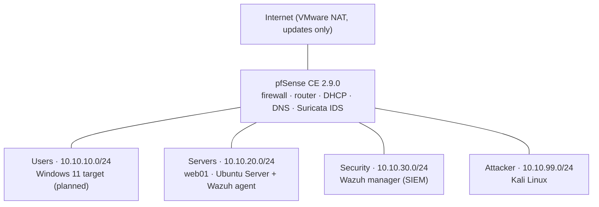
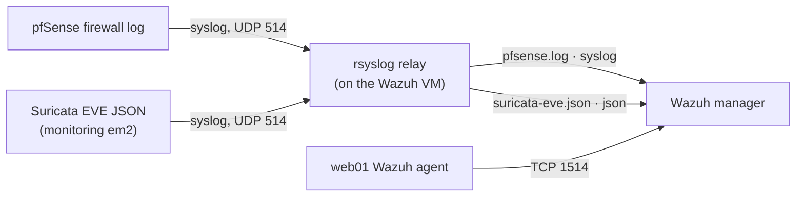

# Home Security Lab

A segmented virtual network that I built and defend: a pfSense firewall routing four isolated zones, Suricata IDS, a Wazuh SIEM, a Linux target server, and a Kali attacker VM. I generate controlled activity from the attacker zone, verify what the firewall, IDS and SIEM detect, fix the gaps, and document each detection.

Everything runs in VMware Workstation Pro on a 16 GB laptop. All testing stays inside the lab.

**Status legend:** ✅ verified with evidence · 🟡 in progress · ⬜ planned

---

## Current status (October 27, 2026)

| Phase | Scope | Status |
|---|---|---|
| 1 · Network foundation | pfSense, four zones, default-deny firewall rules | ✅ Complete (14 of 14 verification tests passed) |
| 2 · Targets + SIEM | web01, Wazuh manager and agent, pfSense and Suricata logs into Wazuh | 🟡 Core pipeline verified; DVWA installed; Apache logging and Windows target remaining |
| 3 · Attack and detect | Techniques 1–5 | ⬜ Planned |
| 4 · Write-ups + polish | Techniques 6–10, final documentation | ⬜ Planned |

---

## Architecture



Each zone is a separate VMware LAN Segment on its own pfSense interface, so every connection between zones is routed and filtered by pfSense. Moving the zones to tagged 802.1Q VLANs on a single trunk is a planned extension.

### Network zones

| Zone | pfSense interface | Subnet | Gateway | Addressing |
|---|---|---|---|---|
| Users | LAN (em1) | 10.10.10.0/24 | 10.10.10.1 | DHCP .100–.200 |
| Servers | SERVERS (em2) | 10.10.20.0/24 | 10.10.20.1 | DHCP .100–.200; statics below .100 |
| Security | SECURITY (em3) | 10.10.30.0/24 | 10.10.30.1 | Static only |
| Attacker | ATTACKER (em4) | 10.10.99.0/24 | 10.10.99.1 | DHCP .100–.200 |

### Virtual machines

| VM | OS | Zone | Address | RAM | Role |
|---|---|---|---|---|---|
| lab-pfSense | pfSense CE 2.9.0 | All (router) | .1 in each zone | 2 GB | Firewall, router, Suricata IDS |
| lab-web01 | Ubuntu Server 26.04.1 LTS | Servers | 10.10.20.10 | 1 GB | Target server (SSH, DVWA) |
| lab-wazuh | Ubuntu Server 24.04.5 LTS + Wazuh 4.14.9 | Security | 10.10.30.10 | 1.5 GB | SIEM and log relay |
| lab-kali | Kali Linux rolling (command line) | Attacker | 10.10.99.100 | 2 GB | Attacker VM |
| Windows target | Windows 11 evaluation | Users | DHCP | 3 GB | ⬜ Planned (Sysmon + Wazuh agent) |

### Firewall policy

Default deny between zones: anything not explicitly allowed is blocked and logged. Every pass rule logs too.

- **Users:** web ports (80, 443) to the Servers zone, DNS to pfSense, Internet only.
- **Servers / Security:** DNS to pfSense and Internet for updates; Servers may reach the Wazuh manager on agent ports 1514–1515.
- **Attacker:** may reach the Users and Servers zones (simulating an attacker with a foothold). No Internet, no DNS, no access to the Security zone.
- **Management:** the pfSense web interface is reachable only from the host machine.

---

## Detection pipeline



- **pfSense firewall events** are sent over syslog to an rsyslog relay on the Wazuh VM. The relay adds the hostname that pfSense's BSD syslog format omits, so Wazuh's built-in pfSense decoders can parse them.
- **Suricata** runs in IDS (alert-only) mode on the Servers interface with Emerging Threats Open rules (attack_response, exploit, scan, web_server). The relay splits its EVE JSON events into a separate file, which Wazuh reads as JSON so its built-in Suricata rules apply.
- **web01** reports to Wazuh through the Wazuh agent.

The relay and Wazuh input configuration, and the Suricata settings, are in [`configs/`](configs/).

---

## Verified results

| Test | Evidence | Status |
|---|---|---|
| Zone segmentation and default-deny policy | 14 tests from Kali and web01; blocks visible in the pfSense firewall log | ✅ |
| Failed SSH logins from the Attacker zone | Wazuh alert from web01's agent showing source 10.10.99.100 | ✅ |
| Blocked Attacker-zone traffic raises SIEM alerts | Wazuh rules 87701 (level 5) and 87702 "Multiple pfSense firewall blocks from same source" (level 10) | ✅ |
| Firewall pass events reach the SIEM | ATTACKER pass-rule hit in the pfSense log and in Wazuh's pfSense log | ✅ |
| Suricata alert reaches the SIEM end to end | Benign trigger text sent from Kali to web01: Suricata SID 2100498 fired, and Wazuh raised rule 86601 "Suricata: Alert - GPL ATTACK_RESPONSE id check returned root" | ✅ |

---

## Planned detections (MITRE ATT&CK)

| # | Technique | ATT&CK ID | Expected detection | Status |
|---|---|---|---|---|
| 1 | Network service scanning | T1046 | Suricata, pfSense blocks | ⬜ |
| 2 | SSH brute force | T1110.001 | Wazuh (auth.log) | ⬜ |
| 3 | Login with a valid account | T1078 | Wazuh login alerts, unusual source zone | ⬜ |
| 4 | Account creation | T1136 | Wazuh (Linux, Windows event 4720) | ⬜ |
| 5 | Scheduled job persistence | T1053 | Wazuh file integrity monitoring | ⬜ |
| 6 | Command and script execution | T1059 | Wazuh + Sysmon | ⬜ |
| 7 | Lateral movement | T1021 | pfSense rule hits, Wazuh | ⬜ |
| 8 | Log clearing | T1070 | Wazuh (Windows event 1102) | ⬜ |
| 9 | Web application attack (DVWA) | T1190 | Suricata web rules | ⬜ |
| 10 | Unusual outbound transfer | T1048 | pfSense egress rules, Suricata | ⬜ |

Each completed detection gets its own folder under `detections/` with the test procedure, actual results, the rule involved, a false-positive check, and response steps.

---

## Troubleshooting highlights

Real problems from the build and how they were found. The full list, with diagnosis steps for each, is in the [troubleshooting log](docs/troubleshooting-log.md).

- **Suricata showed no alerts.** The test pings were aimed at pfSense's own interface addresses, so they never crossed the monitored interface, and plain ICMP matched no enabled rule anyway. A test that actually crossed the Servers interface with known trigger content confirmed the sensor worked. *Lesson: a sensor only sees its own interface, and a test must contain what the rule looks for.*
- **Suricata alerts reached Wazuh but raised no alert.** `wazuh-logtest` showed no decoder matched: the JSON arrived wrapped in a syslog header, so it fell through to a generic low-level rule. Splitting the JSON into its own file read as `json` fixed it.
- **Suricata events arrived cut off.** Some lines stopped at exactly 986 characters, the BSD syslog size limit, so Wazuh couldn't parse them. Turning off payload and traffic logging keeps every alert under the limit.
- **The server zone couldn't ping out or sync its clock.** The firewall log showed default-deny blocks for ICMP and NTP from web01: the "updates" rule had been created with pfSense's default protocol, TCP. Setting it to Any fixed both.
- **pfSense logs reached Wazuh but raised no alerts.** pfSense's BSD syslog omits the hostname, so Wazuh misread the message. Found with `tcpdump` and `wazuh-logtest`; fixed with the rsyslog relay.
- **Wazuh agent stuck at "Unknown".** The manager's disk was full because the Ubuntu installer used only half the LVM volume. Fixed with `lvextend`.
- **New zones could not resolve names.** Default deny blocked DNS until each zone got its own DNS rule.

---

## Repository layout

```
home-security-lab/
├── README.md        overview, architecture, results, lessons learned
├── configs/         relay, Wazuh input and Suricata configuration
├── docs/            troubleshooting log and supporting documentation
├── diagrams/        network diagrams (PNG + editable source)
├── network/         sanitized firewall rules and network documentation
├── detections/      one folder per technique: procedure, rule, evidence, write-up
├── hardening/       security checks with before/after results
└── automation/      configuration backup and audit scripts
```

---

## Lab rules

- All testing stays inside the lab. Nothing is scanned or attacked outside it.
- Attacker and target VMs sit only on isolated VMware LAN Segments, never bridged to a real network.
- Only pfSense's WAN side reaches the Internet, through NAT.
- Snapshots before every test, so any VM can be rolled back.
- No real passwords or personal data on any lab VM; screenshots and configs are sanitized before publishing.
